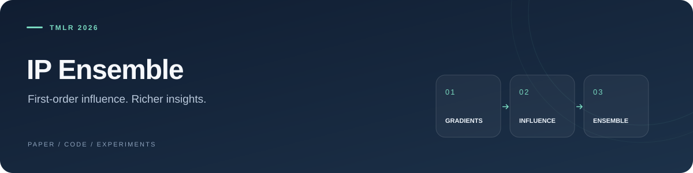

## Revisit, Extend, and Enhance Hessian-Free Influence Functions

**Ziao Yang**, Han Yue, Jian Chen, and Hongfu Liu  
*Transactions on Machine Learning Research · 2026*

[Read the PDF](https://arxiv.org/pdf/2405.17490) &nbsp; / &nbsp; [Paper](https://arxiv.org/abs/2405.17490)

Explore first-order influence estimation and IP Ensemble across **model utility, fairness, and robustness**.

### Inside the research

**Synthetic experiments** — Start with [`SEC-4-1.py`](synthetic%26adversarial/SEC-4-1.py) for the synthetic-data setup.

**Adversarial experiments** — Follow [`run_adversarial.py`](synthetic%26adversarial/run_adversarial.py) and its [launcher](synthetic%26adversarial/run_adversarial.sh).

**Fairness & robustness** — The objective functions live in [`fair_fn.py`](synthetic%26adversarial/fair_fn.py) and [`robust_fn.py`](synthetic%26adversarial/robust_fn.py). NLP resources are collected in [`ResponsibleNLP/`](ResponsibleNLP/).

### Working with the code

```bash
git clone https://github.com/yangziao56/Inner_Product_Ensemble.git
cd Inner_Product_Ensemble
pip install -r requirements.txt
```

Experiment scripts and dataset configurations are organized by task in [`synthetic&adversarial/`](synthetic%26adversarial/).

---

<details>
<summary><strong>Citation</strong></summary>

```bibtex
@article{yang2026innerproductensemble,
  title = {Revisit, Extend, and Enhance Hessian-Free Influence Functions},
  author = {Yang, Ziao and Yue, Han and Chen, Jian and Liu, Hongfu},
  year = {2026},
  journal = {Transactions on Machine Learning Research},
  url = {https://openreview.net/forum?id=ijL2681Tau}
}
```

</details>
